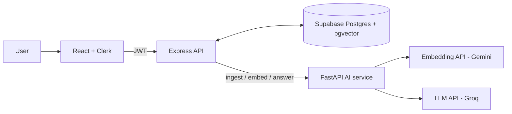

<div align="center">

# 🧠 DocuMind AI

**Talk to your documents with AI.**
Upload PDFs, DOCX or TXT files, ask questions in plain language, and get answers grounded in your own content, with source citations.


</div>

---

## ✨ Features

| | |
|---|---|
| 🔐 **Secure auth** | Sign up, login, logout and profile via Clerk. Every API call is verified. |
| 📄 **Smart ingestion** | PDF, DOCX and TXT are parsed, cleaned, chunked (page-aware) and embedded. |
| 🔎 **Semantic search** | pgvector cosine similarity finds meaning, not just keywords. |
| 💬 **RAG chat** | Markdown answers, chat history, copy, regenerate, scope chat to one document. |
| 📌 **Citations** | Every answer shows the file, page and exact passage it came from. |
| 🛡️ **Hallucination control** | The model only sees retrieved context and says so when it can't find an answer. |
| 📊 **Analytics** | Uploads over time, questions asked, most cited documents, storage used. |
| 📱 **Responsive UI** | Clean SaaS-style layout with loading, empty and error states. |

## 🏗️ Architecture



## 🔁 How RAG works

1. **Upload**: the server validates type and size, and the AI service extracts text, splits it into 1000-character chunks (150 overlap) and creates embeddings.
2. **Store**: chunks and vectors are saved in Supabase (`vector(768)`, HNSW index).
3. **Ask**: your question is embedded and the top matching chunks are retrieved with `match_chunks`.
4. **Answer**: the chunks are sent to the LLM with a strict "answer only from context" prompt.
5. **Cite**: the retrieved passages are returned as clickable sources. If nothing relevant is found, a fixed fallback message is shown and the LLM isn't called.

## 🧰 Tech stack

- **Frontend:** React, Vite, Tailwind CSS, React Router, Lucide, Recharts
- **Backend:** Node.js, Express, Helmet, rate limiting, Multer
- **AI service:** Python, FastAPI, pypdf, python-docx, httpx
- **Data:** Supabase PostgreSQL with pgvector
- **Auth:** Clerk
- **LLM / embeddings:** any OpenAI-compatible API (defaults: Groq and Gemini)

## 📁 Project structure

```text
documind-ai/
├── client/        # React app
├── server/        # Express API (auth, DB, orchestration)
├── ai-service/    # FastAPI: extraction, chunking, embeddings, LLM
├── database/      # schema.sql
├── sample/        # demo document
├── .env.example
└── README.md
```

## 🚀 Getting started

### Prerequisites
Node.js 18+, Python 3.10+, and free accounts on [Supabase](https://supabase.com), [Clerk](https://clerk.com), [Groq](https://console.groq.com) and [Google AI Studio](https://aistudio.google.com).

### 1. Database
Create a Supabase project, open **SQL Editor**, and run `database/schema.sql`.

### 2. Environment variables
Copy the matching sections of `.env.example` into `client/.env`, `server/.env` and `ai-service/.env`.

| File | Key variables |
|---|---|
| `client/.env` | `VITE_API_URL`, `VITE_CLERK_PUBLISHABLE_KEY` |
| `server/.env` | `CLERK_PUBLISHABLE_KEY`, `CLERK_SECRET_KEY`, `SUPABASE_URL`, `SUPABASE_SERVICE_ROLE_KEY`, `AI_SERVICE_URL`, `AI_SERVICE_KEY` |
| `ai-service/.env` | `AI_SERVICE_KEY`, `LLM_BASE_URL`, `LLM_API_KEY`, `LLM_MODEL`, `EMBEDDING_BASE_URL`, `EMBEDDING_API_KEY`, `EMBEDDING_MODEL`, `EMBEDDING_DIM` |

> `SUPABASE_URL` must be just `https://xxxx.supabase.co` (no `/rest/v1`). `AI_SERVICE_KEY` must match in `server` and `ai-service`.

### 3. Run the three services

```bash
# Terminal 1: AI service
cd ai-service
python -m venv .venv && source .venv/bin/activate   # Windows: .venv\Scripts\activate
pip install -r requirements.txt
uvicorn app.main:app --port 8000

# Terminal 2: API server
cd server && npm install && npm run dev

# Terminal 3: client
cd client && npm install && npm run dev
```

Open **http://localhost:5173**, sign up, upload `sample/sample-notes.txt` and ask *"What is overfitting?"*.

## 🔌 API

All routes require a Clerk bearer token.

| Method | Endpoint | Purpose |
|---|---|---|
| POST | `/api/documents/upload` | Upload and process a document |
| GET | `/api/documents` | List documents |
| GET / DELETE | `/api/documents/:id` | Document details / delete |
| GET | `/api/search?q=` | Semantic search across documents |
| POST | `/api/chat` | Ask a question (RAG) |
| GET | `/api/conversations` | List conversations |
| GET / DELETE | `/api/conversations/:id` | Open / delete a conversation |
| GET | `/api/analytics` | Usage stats |

## 🗄️ Database schema

`documents` · `document_chunks` (with `vector(768)` embeddings) · `conversations` · `messages`, plus the `match_chunks` similarity function. Row-level security is enabled, and the API filters every query by `user_id`.

## ☁️ Deployment

- **Client → Vercel:** root `client`, set the `VITE_*` variables (`vercel.json` handles SPA routing).
- **Server → Render / Railway:** root `server`, start command `npm start`, set `CLIENT_ORIGIN` to your Vercel URL.
- **AI service → Render / Railway:** root `ai-service`, start command `uvicorn app.main:app --host 0.0.0.0 --port $PORT`.

## 🩺 Troubleshooting

| Problem | Fix |
|---|---|
| `Invalid path specified in request URL` | Remove `/rest/v1` from `SUPABASE_URL`. |
| Document status **Failed** | Check the AI service terminal and your Gemini key and model. |
| `LLM provider request failed` | Set `LLM_MODEL` to a model listed in your Groq console. |
| Answers always say "couldn't find" | Lower `MIN_SIMILARITY` in `server/.env` (for example `0.1`). |

## 🔒 Security

Uploads are validated by type and size, filenames are sanitized, the service-role key never reaches the browser, all data access is scoped per user, and `.env` files are git-ignored. Never commit real keys.


```

## 🛣️ Roadmap

Streaming responses · hybrid keyword + vector search · OCR for scanned PDFs · Supabase Storage for original files · dark mode.

## 👩‍💻 Author

**Simran Kaur**

---

<div align="center">If you found this useful, consider giving it a ⭐</div>